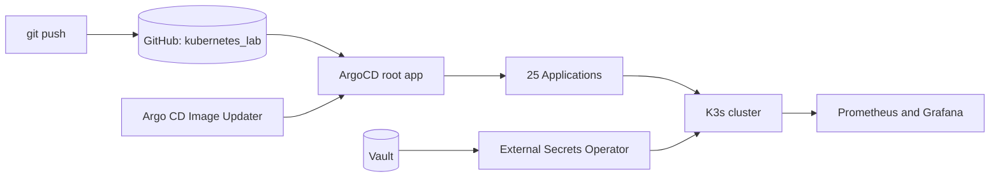

# Kubernetes Lab: GitOps on K3s

A 4-node K3s homelab where every service is deployed from this repository by
ArgoCD using the app-of-apps pattern. I use it to practice the daily work of SRE
and DevOps: GitOps, secrets management, observability and CI/CD.

## Architecture

- **Cluster:** K3s v1.35 on Ubuntu 24.04, 1 control plane (`kubecp`) and 3 workers (`kube001-003`) on repurposed PCs
- **GitOps:** a `root` ArgoCD Application manages every app in `apps/`; Argo CD Image Updater tracks new image tags
- **Secrets:** HashiCorp Vault synced by External Secrets Operator through a ClusterSecretStore; each app has a matching `<app>-secrets` Application; Vault's Kubernetes auth is managed with Terraform (`terraform/vault`)
- **Ingress and TLS:** Traefik with cert-manager (Let's Encrypt, Cloudflare DNS challenge)
- **Observability:** kube-prometheus-stack (Prometheus, Alertmanager, Grafana), ServiceMonitors, Uptime Kuma, Homepage dashboard

## Services

| Area | Services |
| --- | --- |
| Platform | ArgoCD, Argo CD Image Updater, cert-manager, External Secrets, Vault, Traefik |
| CI/CD and registry | Forgejo (self-hosted Git), Harbor (registry), Jenkins |
| Observability | kube-prometheus-stack, Uptime Kuma, Homepage |
| Infrastructure tooling | NetBox |
| Self-hosted apps | Vaultwarden, Linkding, Immich, Jellyfin, music stack |

## Repository layout

| Path | Contents |
| --- | --- |
| `apps/` | ArgoCD Application manifests (app-of-apps) |
| `argocd/` | ArgoCD configuration and ingress |
| `bootstrap/` | Cluster bootstrap resources |
| `manifests/` | Per-app manifests and Helm values |
| `terraform/vault/` | Vault Kubernetes-auth configuration |
| `vault/` | Vault deployment |

## Roadmap

- GitHub Actions pipeline: build, push to Harbor, Image Updater rolls out the tag
- Operator-managed Postgres for Harbor with generated credentials
- Alerting rules and SLO dashboards per service
- Wazuh and host-level CrowdSec

## Lessons learned

- Cluster-level CrowdSec didn't fit this setup, so it moved to the host
- Replaced Gitea with Forgejo
